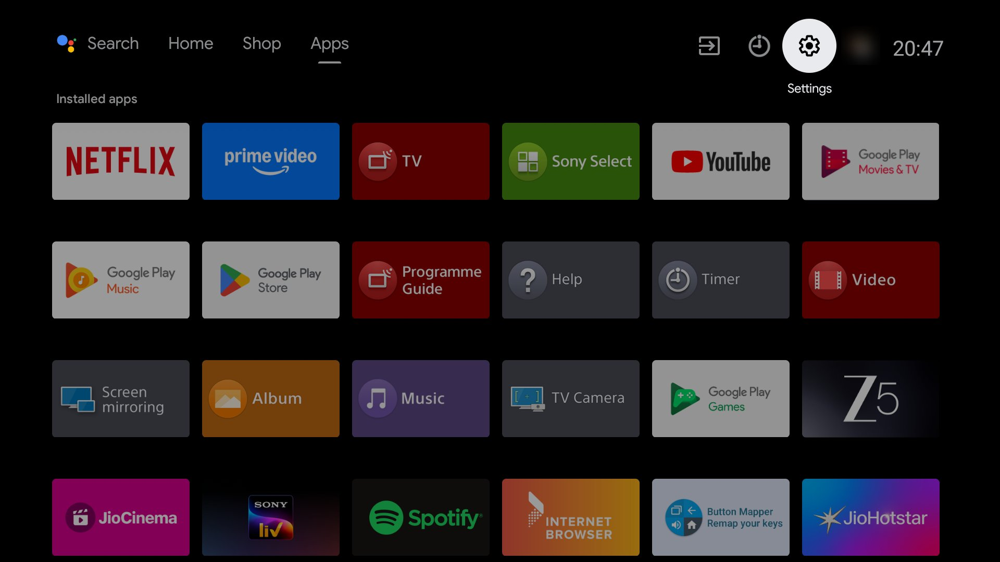
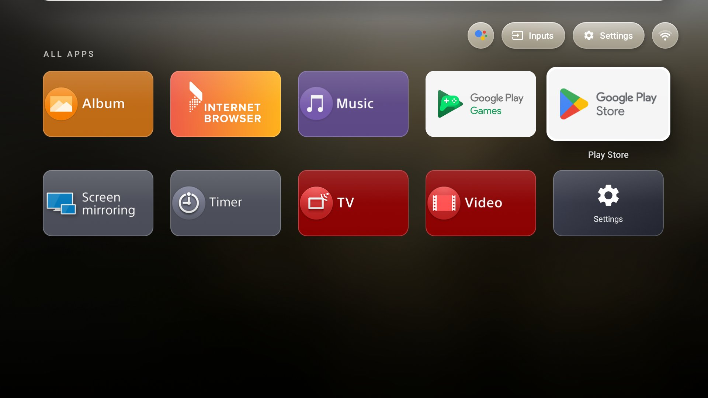

# TV_debloat

De-bloat an old Android TV over Wi-Fi, reversibly, then replace its ad-filled home
screen with **Glass Home**: a fast, minimal launcher inspired by tvOS 26's frosted-glass look.

Built for a **Sony BRAVIA 2015 (Android TV 8.0, ARMv7, 1.6 GB RAM)**, a TV that had
140 MB of free RAM and a home screen full of "Sponsored" rows.

| Before: stock launcher | After: Glass Home (All Apps) |
|---|---|
|  |  |

## What's in here

| Folder | What it does |
|---|---|
| [`debloat/`](debloat/) | Backup + reversible `pm disable-user` of ads, telemetry and junk, with a one-command restore |
| [`launcher/`](launcher/) | Glass Home source: a single-activity, dependency-free Java launcher (~37 KB APK) |
| [`wallpapers/`](wallpapers/) | How to turn your own TV's screensaver photos into wallpapers |

## 1. De-bloat (reversible)

Nothing is uninstalled. Every package is disabled with `pm disable-user`, and a backup
of the package and settings state is taken first.

1. On the TV: **Settings → About → Build** (tap 7×), then **Developer options → Network debugging: on**.
2. Install [Android platform-tools](https://developer.android.com/tools/releases/platform-tools) (for `adb`).
3. Preview, then apply:

```powershell
powershell -ExecutionPolicy Bypass -File debloat\apply.ps1 -TvIp <tv-ip> -DryRun
powershell -ExecutionPolicy Bypass -File debloat\apply.ps1 -TvIp <tv-ip>
```

Accept the **"Allow debugging?"** prompt on the TV the first time.

Undo everything at any time:

```powershell
powershell -ExecutionPolicy Bypass -File debloat\restore.ps1 -TvIp <tv-ip>
```

### What gets disabled

See [`debloat/debloat-list.txt`](debloat/debloat-list.txt), grouped by reason:

- **Ads/promos:** Sony Select, Sony Discovery, recommendation feeds, the dead Play Music
- **Telemetry:** Sony device analytics (reads app usage stats, can reboot the TV), an
  action-log collector, Sony Enclave, Google feedback and bug-report senders
- **Hotel/pro/retail mode:** B2B packages, including one that ran a `node` process all the time
- **Optional:** live-TV extras, TV Camera, Help, and apps you don't use. Edit the list first.

> ⚠️ **Model-specific.** This list was tested on one BRAVIA model. Two lessons from doing it:
> - `com.sony.dtv.b2b.hotelmode` must stay **enabled**: Sony's Settings app reads a provider
>   from it and shows a blank, dimmed panel without it.
> - `com.sony.dtv.scrums.action` looks like telemetry but is the Google Home / Assistant
>   bridge for the remote's action key. Keep it if you use Assistant.
>
> On Sony TVs, HDMI inputs run through the same TV-player and input services as live TV, so
> those are never disabled.

## 2. Glass Home launcher

- **Full-bleed photo wallpaper** with a slow zoom cross-fade every 15 minutes
- **Greeting clock**: "GOOD EVENING", a large thin clock and the date
- **Frosted glass** for the dock and the top-right controls (Assistant, Inputs, Settings, live Wi-Fi)
- **Depth:** wallpaper parallax, a floating dock shadow, and a frosted, dimmed grid view
- **Motion:** tiles swing in with a 3D tilt in the direction of travel and settle on a spring,
  with a white focus ring and a specular sweep
- **Dock** of favourite apps that scrolls column by column, aligned with the grid
- **Hold OK** (or Menu) on any app: move it, add/remove it from the dock, next wallpaper, App Info
- About 33 MB RAM in use, compared with about 70 MB for the stock Google TV launcher

### How the frosted glass works on Android 8

`RenderEffect` blur only exists on Android 12+, and real-time blur is too heavy for this
chip anyway. Instead, the wallpaper keeps a **96×54 box-blurred copy** of the current photo.
Each glass surface (`GlassDrawable`) draws that tiny bitmap through a `BitmapShader` whose
matrix is the wallpaper's transform offset by the surface's on-screen position. Then it adds a
tint, a top highlight and a gradient rim. The result lines up exactly with the photo behind it,
follows the parallax and cross-fades, and costs one small bitmap draw per surface.

### Build

No Gradle. The build is aapt2 → javac → d8 → zipalign → apksigner. You need a JDK and two
pieces of the Android SDK: **build-tools 34** and **platform 34** (`android.jar`).

```bash
cd launcher
BUILD_TOOLS=/path/to/build-tools/34.0.0 ANDROID_JAR=/path/to/platforms/android-34/android.jar ./build.sh
```

> d8 from build-tools 34 crashes on *non-static* inner/anonymous classes compiled by recent
> JDKs (nameless `MethodParameters` entries). That's why every helper class in
> `HomeActivity.java` is a static nested class and listeners are lambdas.

### Install and make it the default

```bash
adb install -r GlassHome.apk
adb shell cmd package set-home-activity app.glasshome.tv/.HomeActivity
# optional: free ~70 MB by turning off the stock launcher (restore.ps1 turns it back on)
adb shell pm disable-user --user 0 com.google.android.tvlauncher
```

### Wallpapers

The repo ships **no photos**. Without any, Glass Home uses a dark gradient. Put your own
1920×1080 JPEGs in `launcher/assets/wall/` before building. [`wallpapers/`](wallpapers/)
explains how to capture your TV's own screensaver photos for personal use.

## Licence

Code: [MIT](LICENSE). App names and banners shown in screenshots belong to their owners.
Not affiliated with Apple, Google or Sony.
